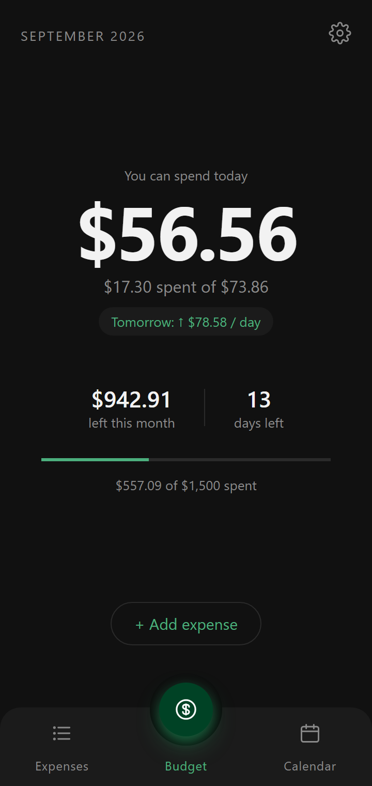
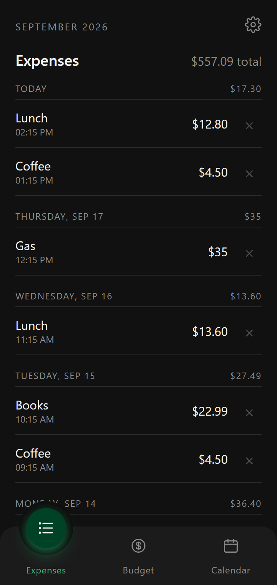
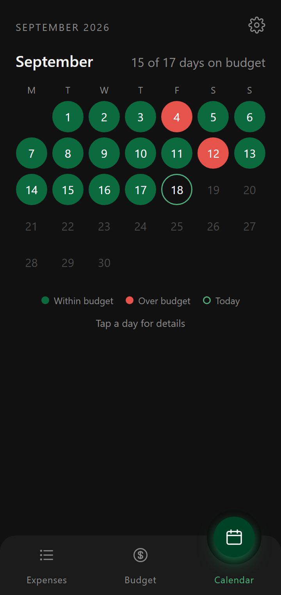

# Daily Budget

An offline Android app that turns a monthly budget into one number: how much you can spend today.
Spend more today and tomorrow's number shrinks; spend less and it grows.

The UI is plain HTML, CSS and JavaScript running in an Android WebView, with a thin Java shell
around it and a home-screen widget. No frameworks, no build step for the UI and no network access.
The one dependency is Google's Play Billing Library, for the optional pay-what-you-want Pro unlock.
The whole app is about 2,500 lines plus the widget's layouts, so you can read all of it in an
afternoon and bend it into whatever you want.

> This repository is the proof of concept behind [PerDay](https://getperday.com).

<p align="center">
  
  
  
</p>

<!-- Demo GIF or short screen recording goes here (e.g. adding an expense and watching tomorrow's allowance change). -->

## Motivation

A monthly budget is easy to set and hard to follow. "$942 left with 13 days to go" is accurate, but
it doesn't answer the question you have at the checkout: *can I afford this right now?* So you do
the division in your head, round in your own favour, and find out weeks later whether it worked.

Daily Budget was built to test one idea: if you turn the monthly budget into a single number for
*today*, and let the following days absorb whatever you over- or under-spend, is that enough to keep
a whole month on track? No categories, no envelopes, no bank sync. You log what you spend and look
at one number. A bad day doesn't ruin the month, it just makes the next few days a little tighter.

To find out quickly, it was built as the smallest thing that could work. The interface is a static
web page, so it could be iterated on in a desktop browser, and the Java side only does what a web
page can't: colour the system bars, handle the back button and post a morning notification.

The idea held up. The app shipped on
[Google Play](https://play.google.com/store/apps/details?id=com.aimbire.dailybudget), and the idea is
now being developed further as [PerDay](https://getperday.com). This repository stays as the
original, compact implementation, and it's a reasonable starting point if you want your own take:
a different formula, weekly budgets instead of monthly ones, another platform, or just a template
for a WebView-wrapped Android app.

## Quick Start

### Run the UI in a browser

The UI is static files in [`app/src/main/assets/www`](app/src/main/assets/www), and nothing needs
compiling. Serve the folder with any static file server and reload the page after you edit something:

```sh
python -m http.server 8765 --directory app/src/main/assets/www
```

On Windows without Python, use the included server (pass `-Port` to change the port):

```powershell
powershell -ExecutionPolicy Bypass -File tools/serve.ps1
```

Then open <http://localhost:8765/>. Data is saved to the browser's `localStorage` under the key
`dailyBudget.v1`, so clear that to start over. The Android bridge doesn't exist in a browser, so the
notification settings, system-bar colours and purchases do nothing there (the Pro dialog shows
sample prices). Everything else works the same.

The UI follows the browser's language. Add `?lang=pt` or `?lang=es` to the address to see another
one; dates and numbers still follow the browser.

### Build and run on Android

You need JDK 17 or newer and the Android SDK with platform 36. Android Studio includes both, and you
can open the repository folder in it and press Run. The app runs on Android 8.0 (API 26) and later.

From the command line, tell Gradle where the SDK is, either with `ANDROID_HOME` or a
`local.properties` file in the repository root (it's git-ignored):

```properties
sdk.dir=/path/to/Android/Sdk
```

On Windows, escape the path: `sdk.dir=C\:\\path\\to\\Android\\Sdk`. Then, with a device or emulator
connected:

```sh
./gradlew installDebug           # Windows: gradlew.bat installDebug
```

`./gradlew assembleDebug` builds the APK without installing it, at
`app/build/outputs/apk/debug/app-debug.apk`.

If the Google Play version is installed on the same device, uninstall it first, because the
signatures differ (uninstalling deletes its data). Or give your build its own application ID (see
[Make it your own](#make-it-your-own)) and keep both.

### Debugging

- `console.log` output from the WebView goes to logcat under the tag `DailyBudget`:
  `adb logcat -s DailyBudget`.
- To check the notification without waiting for the morning, turn on the reminder in Settings and
  tap **Send test notification**. That button only appears in the Android app.
- Debug builds have a **Debug build: lock / unlock Pro** button in the Pro dialog (Settings → Pro),
  so you can try the widget without buying anything.
- Debug builds also include a screen that shows all four widget layouts at once. The extras are
  optional: `theme` and `colors` override the settings, and `sample` swaps in example data, only
  while the screen is drawn.

  ```sh
  adb shell am start -n com.aimbire.dailybudget/.WidgetPreviewActivity \
      --es theme light --es colors wallpaper --ez sample true
  ```

## Usage

1. **Set a monthly budget.** On first launch the app asks for one. The same amount applies every
   month, and each month starts fresh.
2. **Log expenses as you spend.** Tap **+ Add expense** on the Budget tab and enter the amount and
   an optional note. Expenses are recorded for today.
3. **Check today's number.** The **Budget** tab shows what you can still spend today and how much
   of today's allowance you've used. Below that, **Tomorrow** shows the allowance you'll get if you
   spend nothing more today, with an arrow if it's higher or lower than today's, followed by what's
   left this month and how many days remain. If you go over, the headline shows by how much.
4. **Look back.** **Expenses** lists this month's expenses by day with daily totals (tap × to
   delete one). **Calendar** colours each tracked day green (within that day's allowance) or red
   (over it), counts the days on budget, and shows what you spent against the allowance when you tap
   a day.
5. **Adjust settings** with the gear icon: monthly budget, currency symbol (such as $, €, £ or R$),
   theme (dark, AMOLED black, light or same as phone), widget colours (Android 12+), the morning
   reminder and its time, a link to the privacy policy (it opens in the browser) and
   **Reset all data**.
6. **Put today's number on the home screen (Pro).** Settings → Pro unlocks the widget for whatever
   you want to pay: three one-time amounts that all unlock the same thing. Once it's unlocked,
   **Add widget to home screen** places it, or add it from the launcher's widget list. Its **+**
   button opens straight into Add expense.

The morning reminder is a notification with today's number, for example **Today you can spend
$73.86** with *$960.21 left this month · 13 days left* underneath.

## How it works

### The math

```text
daily allowance = (monthly budget − spent before today) / days left in the month (incl. today)
left today      = daily allowance − spent today
```

- Today's allowance is fixed at the start of the day. Spending today lowers what's *left* today, not
  the allowance itself. Any difference is spread over the remaining days, starting tomorrow.
- The "Tomorrow" line is the allowance you'd get if you spent nothing more today:
  `(budget − spent this month) / (days left − 1)`. On the last day of the month it's next month's
  first allowance.
- Once the month's budget is used up, the allowance is 0 until the next month.
- Each month starts fresh with the same budget. Nothing carries over.

For example, with $500 left at the start of the day and 5 days to go (including today), today's
allowance is $100:

| Spent today | Left this month | Tomorrow's allowance |
| ----------: | --------------: | -------------------: |
|        $100 |            $400 |   $400 / 4 = **$100** |
|        $140 |            $360 |    $360 / 4 = **$90** |
|         $60 |            $440 |   $440 / 4 = **$110** |

All of this is `Budget.compute` in [`budget.js`](app/src/main/assets/www/budget.js): one pure
function with no DOM access.

### The WebView and the bridge

[`MainActivity`](app/src/main/java/com/aimbire/dailybudget/MainActivity.java) loads
`file:///android_asset/www/index.html` into a full-screen WebView and exposes a small object to
JavaScript as `window.Android`:

| Call | When the UI calls it | What the Java side does |
| ---- | -------------------- | ----------------------- |
| `setSystemBars(bar, nav, light)` | The theme changes | Colours the status and navigation bars to match the page |
| `syncData(json)` | After every save | Keeps a copy of the data for the notification and the widget, and redraws the widget |
| `setReminder(enabled, hour, minute)` | Reminder settings change | Schedules or cancels the daily alarm, and asks for notification permission on Android 13+ |
| `testReminder()` | **Send test notification** is tapped | Shows the notification immediately |
| `sdk()` | At startup | Returns the Android version, so **Widget colours** only shows on Android 12+ |
| `language()` | At startup | Returns the language Android picked for the widget and notification (`'en'`, `'pt'`, `'es'`), so the page uses the same one |
| `is24Hour()` | Times are shown | Returns the phone's 12/24-hour setting, which the locale's time format ignores |
| `takeLaunchAction()` | At startup | Returns what the widget opened the app for (`'add'`, `'pro'`), once |
| `proState()` | At startup | Returns the Pro state: unlocked or not, prices, pending payments |
| `buyPro(productId)` | An amount is tapped in the Pro dialog | Opens Google Play's purchase sheet |
| `canAddWidget()` / `addWidget()` | **Add widget to home screen** | Asks the launcher to place the widget (it confirms with the user) |
| `debugTogglePro()` | The debug-build button in the Pro dialog | Locks or unlocks Pro without a purchase |

In the other direction, Java calls `window.handleBack()` when the back button is pressed (the UI
closes a sheet or settings, or switches back to the Budget tab, and returns `true`; when there's
nothing left to close it returns `false` and the app exits),
`window.onReminderPermission(granted)` after the permission prompt, `window.onPro(state)` when
purchases or prices change, and `window.onLaunchAction(action)` when the widget opens the app while
it's already running. Every bridge call in `app.js` checks that `window.Android` exists first, which
is why the same files run unchanged in a desktop browser.

### Storage

All state is a single JSON object in `localStorage` under `dailyBudget.v1`:

```js
{
  budget: 1500,
  currency: '$',
  expenses: [{ id, ts, day: '2026-09-18', amount: 12.8, note: 'Lunch' }],
  since: '2026-09-01',          // first tracked day, used by the calendar
  theme: 'dark',                // 'dark' | 'amoled' | 'light' | 'system'
  widgetColors: 'app',          // 'app' | 'wallpaper' (Material You, Android 12+)
  reminder: { enabled: true, time: '08:00' },
}
```

Expenses older than 12 months are pruned at startup. The morning notification and the widget can't
read the WebView's storage without opening the app, so `syncData` also keeps a copy in Android
`SharedPreferences`: the budget, currency, theme settings and the last two months' expenses (the
widget's week strip can reach back into last month).
[`Budget.java`](app/src/main/java/com/aimbire/dailybudget/Budget.java) is the Java copy of
`Budget.compute` that both use, and
[`RescheduleReceiver`](app/src/main/java/com/aimbire/dailybudget/RescheduleReceiver.java) re-arms the
alarm and redraws the widget after a reboot, an app update or a clock change.

### The widget and Pro

[`BudgetWidget`](app/src/main/java/com/aimbire/dailybudget/BudgetWidget.java) is one widget with four
layouts, picked by size: just the number (2×1), a ring that empties as you spend today's allowance
(2×2), the number with tomorrow's allowance and a quick-add button (4×1), and the same with the
last seven days in calendar colours (4×2). On Android 12+ the launcher switches layouts as the
widget is resized; older versions pick one from the size the launcher reports.

Its colours follow the app's theme. With **Same as phone** on Android 12+, the launcher switches
between the light and dark colours itself when dark mode changes. **Widget colours → From your
wallpaper** uses the system's Material You colour resources instead, so the widget follows the
wallpaper. It redraws when the app saves, when Pro changes, and just after midnight.

[`Pro`](app/src/main/java/com/aimbire/dailybudget/Pro.java) sells three one-time products
(`pro_small`, `pro_medium`, `pro_large`), and owning any of them unlocks the widget. Google Play
Billing runs through the Play Store app on the device, so there's no server. The unlock is cached
in `SharedPreferences` for the widget and re-checked against Play every time the app resumes, so a
refund locks it again. Without Pro, the widget shows a locked placeholder that opens the Pro dialog.

### Project layout

```text
app/src/main/assets/www/          The UI: plain HTML, CSS and JavaScript, no build step
  index.html                      Tabs, settings page and dialogs
  strings.js                      All the UI's text, in English, Brazilian Portuguese and Spanish
  budget.js                       The budget math (pure functions, no DOM)
  app.js                          Rendering, storage, settings and the bridge calls
  style.css                       Dark, AMOLED and light themes as CSS custom properties
app/src/main/java/com/aimbire/dailybudget/
  MainActivity.java               Full-screen WebView, system bars, back button, JS bridge
  Budget.java                     Java copy of the budget math, and the synced data it reads
  Reminder.java                   Morning notification: scheduling and message text
  ReminderReceiver.java           Shows the notification and arms the next one
  RescheduleReceiver.java         Re-arms the alarm after a reboot, update or clock change
  BudgetWidget.java               Home-screen widget: layouts by size, colours, midnight refresh
  Pro.java                        Pay-what-you-want unlock through Google Play Billing
app/src/main/res/                 Icons, window colours, and the widget's layouts and shapes
app/src/debug/                    Debug builds only: the widget preview screen
docs/                             Privacy policy, release steps and README screenshots
store/                            Google Play listing graphics, and what renders them and the promo video
tools/                            Desktop preview server and release scripts
```

## Make it your own

Some starting points if you fork it:

- **Rename it.** Change `applicationId` and `namespace` in [`app/build.gradle`](app/build.gradle),
  move the Java files out of `com/aimbire/dailybudget/` into your own package and update their
  `package` lines, and set `app_name` in
  [`res/values/strings.xml`](app/src/main/res/values/strings.xml). With its own application ID,
  your build can be installed next to the Play Store version.
- **Restyle it.** The UI colours are CSS custom properties at the top of
  [`style.css`](app/src/main/assets/www/style.css): `:root` for the dark theme,
  `:root[data-theme="amoled"]` for AMOLED black (it only overrides the backgrounds and lines) and
  `:root[data-theme="light"]` for the light one. The system bars pick up `--bg` and `--surface`
  automatically. The window background shown before the page loads and the notification accent are in
  [`res/values/styles.xml`](app/src/main/res/values/styles.xml), and the icons are vector drawables
  in `res/drawable/`.
- **Change the math.** Edit `Budget.compute` in `budget.js`. The notification and the widget
  compute the same numbers in Java (`Budget.compute` in `Budget.java`), so change it there too.
  Ideas: weekly or payday-to-payday
  periods instead of calendar months, carrying leftovers into next month, setting aside a savings
  goal before the daily number is worked out.
- **Change or add a language.** The UI's text is in
  [`strings.js`](app/src/main/assets/www/strings.js), with each string's translations side by side.
  The widget's and the notification's text is in `res/values/strings.xml`, with a copy per language
  in `res/values-pt-rBR/` and `res/values-es/`. To add a language, add its code to `LANGUAGES` and a
  translation to every entry in `strings.js`, and copy `values/strings.xml` to `values-<code>/`,
  setting `lang` to the same code. Android picks which `strings.xml` to use from the phone's
  languages, and the page asks it which one it picked. Dates and numbers follow the phone's locale
  either way.
- **Change what's stored.** If you change the shape of the saved data, migrate it in `load()` in
  `app.js` or bump `STORAGE_KEY`, so existing installs don't break. If the notification or the
  widget needs the new fields, add them to `syncNative()` as well.
- **Move it to another platform.** The web UI doesn't depend on Android. A different shell (an iOS
  `WKWebView`, Electron, a PWA) only has to provide the bridge calls it needs, and can skip the rest.
- **Publish your own build.** [docs/RELEASING.md](docs/RELEASING.md) covers the upload key,
  versioning, the Pro products and the release bundle. The store graphics in `store/` and the
  [privacy policy](docs/privacy-policy.html) belong to this app, including its contact address, so
  replace them with your own.
- **Make the widget free.** Have `Pro.isPro` return `true`, or drop `Pro.java` and the billing
  dependency altogether if you don't sell anything.

The helper scripts in `tools/` and `store/` are PowerShell, written for Windows. Gradle and the
browser preview work on any platform.

## Contributing

Issues and pull requests are welcome.

- **Bugs:** for a wrong number, include the monthly budget, the date and the expenses that produce
  it.
- **Keep pull requests small and focused,** and say how you tested them.
- **Keep it dependency-free.** No frameworks, packages or build step in the UI, and in Java only the
  Android framework plus the Play Billing Library for Pro. Staying small is the point of this
  repository. If your idea needs more than that, a fork is a great home for it.
- **Formula changes go in both places:** `budget.js` and `Budget.java`.
- **Preview UI changes in a desktop browser.** Test on a device or emulator for anything that
  touches notifications, the widget, system bars or the back button.

## Privacy

The manifest doesn't request the `INTERNET` permission, so the app can't send data anywhere. There's
no account, analytics or ads. Everything is stored on the device, in the WebView's `localStorage`
plus the `SharedPreferences` copy used for the notification and the widget. **Reset all data** in
Settings or uninstalling the app deletes it. Android's `allowBackup` is left on, so the user's own
device backup may include it. See the full [privacy policy](docs/privacy-policy.html).

Purchases are handled by Google Play. The Play Billing Library would normally also send its own usage
logs to Google, which is what adds `INTERNET` to an app. [`app/build.gradle`](app/build.gradle)
leaves out the part that sends them (the library skips logging without it), and the manifest
removes `INTERNET` in case another library asks for it. The library still adds
`ACCESS_NETWORK_STATE`, which only lets an app check whether the phone is online. After upgrading
the library, check the merged manifest (`app/build/intermediates/merged_manifest/`) for new
permissions.

## License

No license has been chosen yet. Until one is added, default copyright applies: you can view and fork
the repository on GitHub, but no other rights to use, modify or distribute the code are granted.
